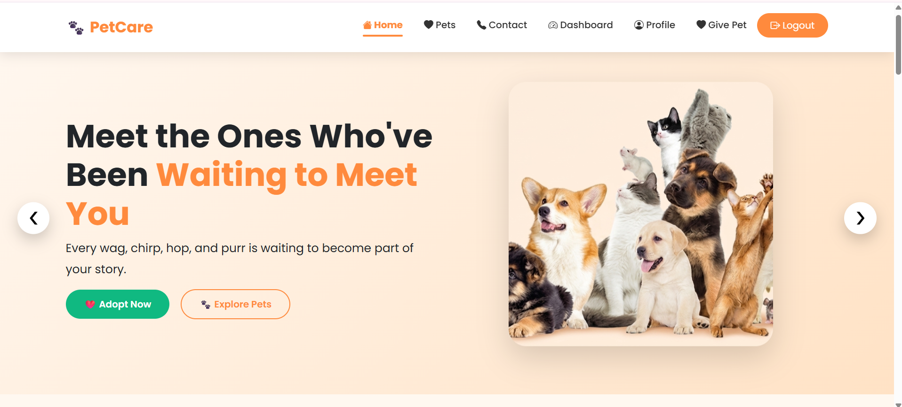
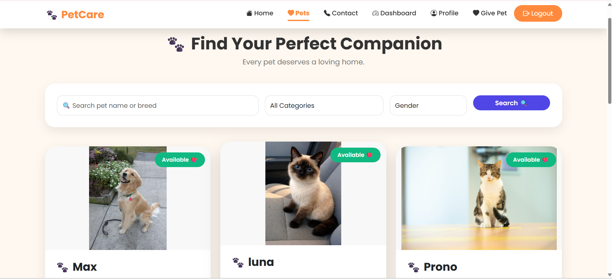
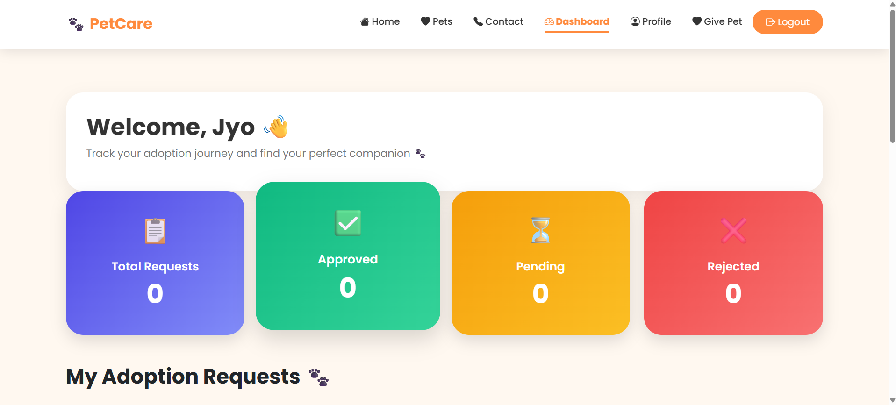

# 🐾 Pet Adoption Portal

A web-based Pet Adoption Portal developed using Python and Django to connect people with pets looking for a loving home. The platform allows users to explore available pets, submit adoption requests, and manage their adoption activities.

## ✨ Features

- **User Registration & Login:** Secure user authentication.
- **Pet Listings:** Browse available pets with images and details.
- **Search & Filters:** Search pets by category, breed, gender, and other details.
- **Adoption Requests:** Submit adoption applications for pets.
- **User Dashboard:** Track adoption requests and their status.
- **Admin Management:** Manage pet listings and approve or reject adoption requests.
- **Pagination:** Browse pet listings with organized pages.
- **Email OTP Verification:** OTP-based registration and password recovery.

## 🛠️ Technologies Used

| Technology | Purpose |
|---|---|
| Python | Backend programming |
| Django | Web framework |
| HTML5 | Page structure |
| CSS3 | Styling |
| Bootstrap | Responsive UI |
| JavaScript | Frontend interactions |
| MySQL | Database |

## 📂 Project Structure

```text
PetAdoptionPortal/
│
├── accounts/          # User authentication and profiles
├── adoption/          # Pet listings and adoption requests
├── pet_adoption/      # Main Django project settings
├── media/             # Uploaded pet images
├── static/            # Static files
├── manage.py
├── requirements.txt
└── README.md
```

## ⚙️ Installation & Setup

### 1. Clone the Repository

```bash
git clone https://github.com/Jyothikadukka/Pet-Adoption-Portal.git
```

### 2. Navigate to the Project Folder

```bash
cd Pet-Adoption-Portal
```

### 3. Create a Virtual Environment

```bash
python -m venv venv
```

### 4. Activate the Virtual Environment

Windows:

```bash
venv\Scripts\activate
```

### 5. Install Dependencies

```bash
pip install -r requirements.txt
```

### 6. Configure the Database

Configure your MySQL database credentials in your environment variables and Django settings.

Create the required database before running migrations.

### 7. Apply Migrations

```bash
python manage.py makemigrations
python manage.py migrate
```

### 8. Start the Development Server

```bash
python manage.py runserver
```

Open your browser and visit:

```text
http://127.0.0.1:8000/
```

## 🎯 Project Objective

The main objective of this project is to simplify the pet adoption process by providing an accessible platform where users can discover pets, request adoptions, and connect with the adoption management system.

## 📸 Screenshots

### Homepage


### Pet Listings


### Dashboard


## 👩‍💻 Developer

**Dukka Jyothika**

GitHub: [Jyothikadukka](https://github.com/Jyothikadukka)

---

⭐ If you find this project interesting, consider giving it a star!
